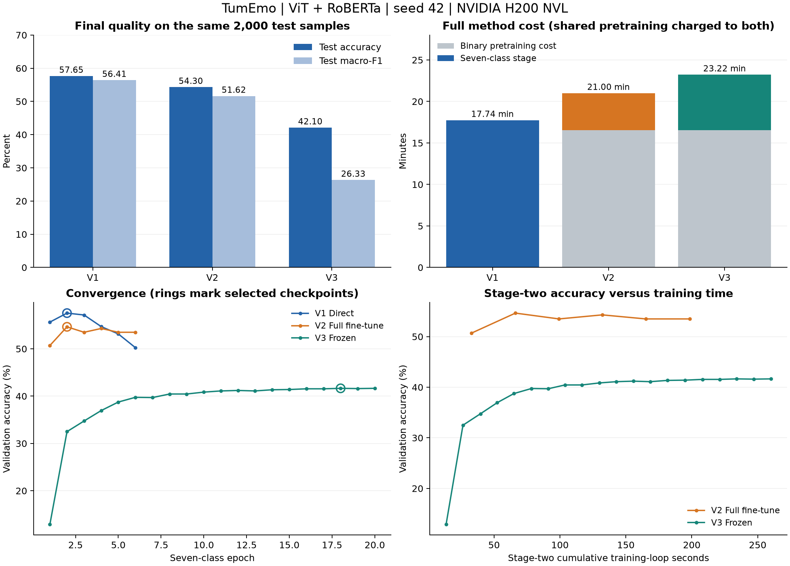

# TumEmo 图文情绪分类：三种训练策略

使用 **ViT-B/16 + RoBERTa-base**，对比直接七分类、二分类预训练后整体微调、二分类预训练后冻结主干三种方案。训练、准确率和效率指标统一记录到 W&B，支持SSH后台队列和checkpoint恢复。

| 方案 | 数据与训练过程 | 七分类阶段更新范围 |
|---|---|---|
| V1 Direct | 20,000 + 5,000条，直接七分类 | ViT、RoBERTa、融合层、分类头 |
| V2 Full | 20,000条二分类 → 5,000条七分类 | 全参数 |
| V3 Frozen | 共享V2的二分类checkpoint → 5,000条七分类 | 仅新分类头，1,799个参数 |

本仓库保存源代码、固定样本清单、测试和已核验的聚合实验报告。数据ZIP、图片/文本、模型权重、环境缓存、运行日志和凭据均不在Git中。

## 已完成的实验

seed42，NVIDIA H200 NVL，batch16，FP32；四个W&B run均已完成，云端summary与逐epoch曲线已和本地记录核对。

| 方案 | 测试accuracy | 测试macro-F1 | 完整方案阶段耗时 | 七分类训练轮数 |
|---|---:|---:|---:|---:|
| V1 Direct | **57.65%** | **0.5641** | **17.74分钟** | 6，最佳第2轮 |
| V2 Full | 54.30% | 0.5162 | 21.00分钟 | 6，最佳第2轮 |
| V3 Frozen | 42.10% | 0.2633 | 23.22分钟 | 20，最佳第18轮 |

完整方案耗时包含设置、训练、验证、保存和最终测试；V2/V3均计入共享二分类的原始成本。冻结版本每步快约2.54倍、第二阶段峰值显存少约81.4%，但训练轮数更多，第二阶段总耗时反而增加约50%。V1使用更多七分类标签，不能把它与V2/V3的差异完全归因于训练策略。



- [完整结果分析与W&B链接](reports/experiment_review.md)
- [checkpoint逐文件对应表](reports/checkpoints.md) / [CSV](reports/checkpoints.csv)
- [可重绘的聚合数据](reports/data/seed42.json)
- [实验配置与比较口径](docs/experiment_protocol.md)

## 目录

```text
tumemo-training/
  training/                 # 训练代码、三个启动器和后台总脚本
  tests/                    # 小模型集成测试、后台队列测试
  tools/plot_results.py      # 从聚合结果重绘图表
  data/manifests/            # 20k/5k训练清单、验证/测试ID清单
  docs/                     # 实验协议、可重复运行说明
  reports/                  # 结果分析、checkpoint索引、图表与聚合指标
  requirements.txt          # 训练依赖；PyTorch单独安装
  requirements-analysis.txt # 可选绘图依赖
  requirements-reproduction.txt # 本次历史实验的PyTorch版本
```

## 创建环境

推荐Linux、Python 3.12、NVIDIA GPU。以下命令均在仓库根目录运行。创建新环境示例：

```bash
python3.12 -m venv .venv
source .venv/bin/activate
python -m pip install --upgrade pip

# 新环境示例：相互匹配的PyTorch / torchvision，CUDA 12.8 wheel
python -m pip install torch==2.10.0 torchvision==0.25.0 --index-url https://download.pytorch.org/whl/cu128
python -m pip install -r requirements.txt
python training/check_environment.py
```

PyTorch和torchvision须匹配，CUDA wheel还需要相容的驱动；请结合本机硬件核对[官方版本对应表](https://github.com/pytorch/vision#installation)。本次报告的实测环境为Python 3.12.0、PyTorch 2.8.0+cu128、torchvision 0.23.0+cu128；上面的2.10环境示例尚未重跑完整实验，改变框架版本后应重新验证，不应期待逐位相同的结果。

如必须在独立环境中重建历史版本，可使用：

```bash
python -m pip install -r requirements-reproduction.txt
```

历史PyTorch 2.8在已知反序列化漏洞影响范围内；只加载可信来源的本地权重，受限加载不代表任意未知checkpoint安全。修复版本和边界见[官方公告](https://github.com/pytorch/pytorch/security/advisories/GHSA-63cw-57p8-fm3p)。新训练checkpoint采用受限加载兼容格式；旧可信pickle格式才需要显式 `--trust-legacy-checkpoint`。

## 准备数据和预训练模型

取得有使用权限的 `subset_50000.zip`，放到 `data/subset_50000.zip`。ZIP不需要手动解压，内部必须有：

```text
subset_50000/all_data_id_and_label_with_polarity.txt
subset_50000/all_data/<id>.jpg
subset_50000/all_data/<id>.txt
```

固定清单已经在 `data/manifests/` 中。默认完整使用20,000和5,000训练样本，从剩余样本抽取共同的2,000验证和2,000测试，排除与训练数据重复的图片和规范化非空文本。细节见 [data/README.md](data/README.md)。

```bash
bash training/run_v1_direct.sh --prepare-only
```

首次正式训练会下载ImageNet ViT权重及 `FacebookAI/roberta-base` 权重/分词器。启动脚本默认把缓存放在仓库 `.cache/`；已有缓存可通过 `HF_HOME`、`TORCH_HOME` 指定。联网预先缓存后可设置 `HF_HUB_OFFLINE=1` 使用本地Hugging Face模型。

## W&B 登录与训练

前台完成登录，不把API key写入代码或命令文件：

```bash
.venv/bin/wandb login
export WANDB_PROJECT=tumemo-training-comparison
export WANDB_RUN_GROUP=three-strategies-seed42
# 如使用团队空间：export WANDB_ENTITY=你的团队名
```

SSH场景推荐一次性后台启动三个实验：

```bash
bash training/run_all_nohup.sh
```

总脚本使用 `nohup + setsid`，按V1 → V2 → V3串行运行，默认GPU 0，避免三版争用GPU造成计时失真。V2完成二分类预训练后，V3复用同一个源checkpoint；失败或正常停止后不会启动下一个版本。

```bash
# 状态与日志
bash training/run_all_nohup.sh status
tail -f training/background_comparison/queue.log
tail -f training/background_comparison/run_v1_direct.log

# 等待当前epoch保存后，停止整个队列
bash training/run_all_nohup.sh stop

# 用相同配置恢复；完成的阶段会跳过
bash training/run_all_nohup.sh -- --resume
```

也可以单独运行：

```bash
bash training/run_v1_direct.sh
bash training/run_v2_finetune.sh
bash training/run_v3_frozen.sh
```

自定义GPU、数据路径和输出目录：

```bash
CUDA_VISIBLE_DEVICES=0 bash training/run_all_nohup.sh \
  --log-dir /absolute/path/experiment_a_logs -- \
  --data /absolute/path/subset_50000.zip \
  --output /absolute/path/experiment_a \
  --batch-size 16 --epochs 20 --binary-epochs 20 --seed 42
```

`--log-dir`是总脚本参数，后面的 `--`分隔训练参数。自定义日志目录后，status/stop/恢复也须使用相同日志目录。恢复时保持数据、输出目录和超参数一致；改变配置使用新输出目录。单阶段手工创建的 `STOP` 文件需自行删除；`--resume`只自动清理总队列自己的STOP。

默认参数：Adam，编码器LR `5e-6`，融合层/分类头LR `1e-4`，weight decay `0.01`，dropout `0.5`，5% warmup + cosine，batch16，FP32，文本最多96 tokens，图片224×224。每阶段最多20轮、连续4轮无提升早停；二分类按验证macro-F1选模，七分类按验证accuracy选模。可用 `bash training/run_v1_direct.sh --help` 查看所有选项。

无网络时显式使用离线记录，联网后同步每个阶段的离线目录：

```bash
WANDB_MODE=offline bash training/run_all_nohup.sh
.venv/bin/wandb sync training/runs_comparison/direct/seed_42/wandb/offline-run-*
```

对比实验保持同一日志模式。`--wandb-mode disabled`只写本地指标；在线登录/同步失败会明确报错，不会悄悄关闭W&B。

## 输出与checkpoint

```text
training/runs_comparison/
  direct/seed_42/
  full/seed_42/
  frozen/seed_42/
  shared_binary/<配置指纹>/seed_42/
  comparison_seed_42.csv
  comparison_seed_42.json
```

每阶段包含 `best.pt`（按指定验证指标）、`best_accuracy.pt`（按验证accuracy）、`last.pt`（最后完整epoch，恢复用）、`config.json`、`history.json`、`efficiency.json`、`results.json`。三个七分类阶段另有 `test_metrics.json`。测试只在验证集选好模型后执行；最终报告使用 `best.pt`，不使用 `last.pt`。

二分类checkpoint用于初始化源特征，不能直接当七分类模型使用。完整checkpoint包含模型、优化器和随机状态，体积通常比纯模型权重大；不会上传到Git。已完成实验的逐文件索引见 [reports/checkpoints.md](reports/checkpoints.md)，这些历史文件仍位于原项目目录。

## 检查与重绘报告

```bash
# 小模型测试，不下载模型，也不进行正式GPU训练；W&B测试需要本地socket权限
python -m unittest discover -s tests -v

# 准备数据并缓存模型之后，两个真实样本的GPU检查
python -u training/smoke_comparison_gpu.py

# 可选：重绘本仓库聚合结果的图表
python -m pip install -r requirements-analysis.txt
python tools/plot_results.py
```

旧的单独二分类入口 `training/run_train.sh ZIP`仍保留，它使用原20k内部训练/验证划分，与三版本实验不同，不应混合比较。新实验请使用三个版本脚本或总脚本。

## 本地Git与后续上传

此目录已整理为本地Git仓库，使用 `main` 分支并包含初始提交；没有创建远程仓库或推送。`.gitignore`排除原始数据、checkpoint、运行输出、缓存和凭据，只跟踪代码、样本ID/标签清单及聚合报告。发布前自行确认数据清单与报告的分享权限，并选择适用的代码许可证。

创建自己的空GitHub仓库后，可在本目录连接并推送：

```bash
git status
git remote add origin <你的GitHub仓库URL>
git push -u origin main
```
