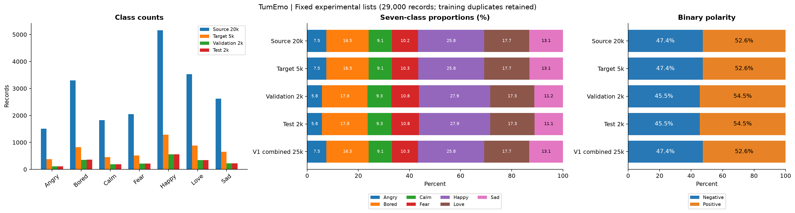
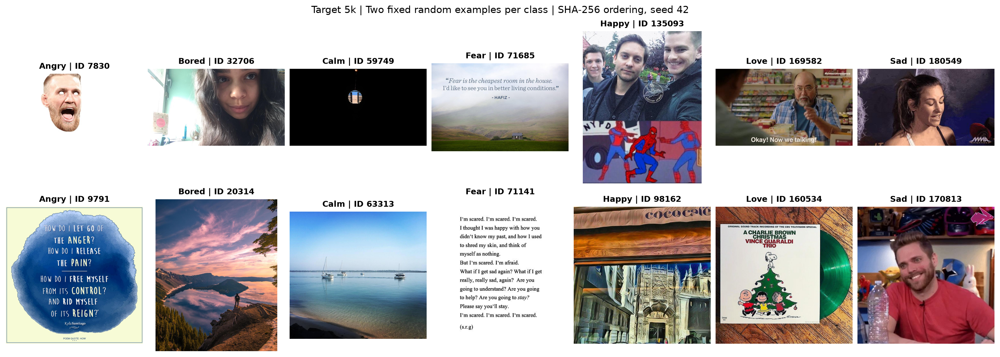
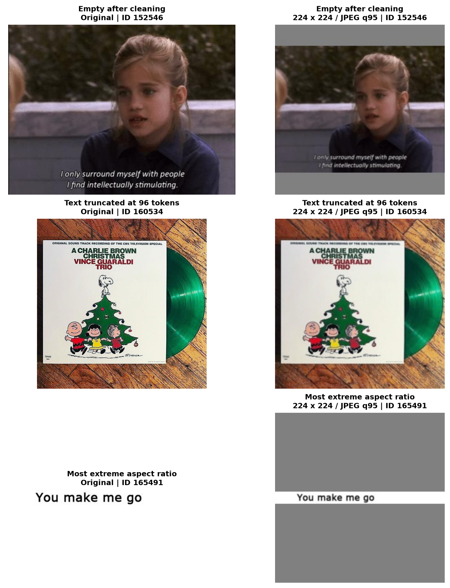

# Dataset-side：数据划分、标签分布与原始样本

本报告展示本次实验实际使用的20k源训练集、5k目标训练集以及固定的2k validation / 2k test。它与[主实验报告](experiment_review.md)、[特征可视化报告](embedding_visualization.md)并列。图表基于原始ZIP和已核验的训练清单生成，没有重新抽取训练/评估划分或修改标签。

## 数据范围与用途

| 划分 | 数量 | 在实验中的用途 |
|---|---:|---|
| Source | 20,000 | V1直接七分类的一部分；V2/V3/V5/V6共享二分类源训练 |
| Target | 5,000 | V1直接七分类的另一部分；V4直接七分类；V2/V3/V5/V6第二阶段 |
| Validation | 2,000 | 监督模型选checkpoint；Qwen零样本评估；特征与错误可视化 |
| Test | 2,000 | 监督模型在validation选模后的最终评估 |

四个划分共29,000条**样本记录**。V1的25k是Source与Target相加，不是第五份独立数据。固定清单来自50k数据包，其余记录不属于本报告的训练、验证或测试统计。

Source与Target没有相同ID，但共享227个原始图片哈希；原训练清单中的重复保留。Validation/Test已排除与全部25k训练记录及彼此之间的精确图片、规范化非空文本重复。这不等于已排除近重复图片或同一用户来源。参见[划分审计](data/dataset_audit.json)和[实验协议](../docs/experiment_protocol.md)。

## 七分类数量与占比

[下载分布图PDF](figures/dataset/label_distribution.pdf)

| 类别 | Source 20k | Target 5k | Validation 2k | Test 2k |
|---|---:|---:|---:|---:|
| Angry | 1,505（7.52%） | 376（7.52%） | 116（5.80%） | 116（5.80%） |
| Bored | 3,298（16.49%） | 825（16.50%） | 356（17.80%） | 357（17.85%） |
| Calm | 1,828（9.14%） | 457（9.14%） | 187（9.35%） | 187（9.35%） |
| Fear | 2,050（10.25%） | 513（10.26%） | 215（10.75%） | 215（10.75%） |
| Happy | 5,160（25.80%） | 1,290（25.80%） | 557（27.85%） | 557（27.85%） |
| Love | 3,533（17.66%） | 883（17.66%） | 346（17.30%） | 346（17.30%） |
| Sad | 2,626（13.13%） | 656（13.12%） | 223（11.15%） | 222（11.10%） |

20k与5k的类别比例几乎一致，不能仅凭类别占比解释二分类迁移方案与V4的性能差异。Happy占两份训练集的25.80%，Angry约7.52%，最大类约为最小类的3.43倍；七类并不均衡，因此主报告同时列accuracy、macro-F1及各类召回率。

Validation的Happy占27.85%、Angry占5.80%，与训练分布存在一定差异；固定validation/test来自去重后的候选池，且两者互相分层划分，因此彼此比例接近。所有实验使用相同评估清单，这种分布差异不会使某个方案单独获得不同的评估集。

正类为Calm/Happy/Love，负类为Angry/Bored/Fear/Sad。训练集正类约52.6%，validation/test为54.5%。二分类接近均衡不意味着七分类也均衡。

## 每类两个原始图文样本

从Target 5k中，每个类别按 `SHA256("42:" + ID)` 排序，固定选择前两个，共14条。选择过程不看模型预测、置信度或图片内容，不筛选“更符合情绪直觉”的例子；所有标签沿用数据集原标注。图片保留原始宽高比，以下为展示缩略图，图中ID与下表逐一对应。

[下载样本展示PDF](figures/dataset/sample_gallery.pdf)

文本表中“…”仅表示报告显示长度限制；**它与模型96-token截断是两回事**。token数使用原训练的RoBERTa tokenizer，包含特殊token。报告只展示少量图片缩略图和文本节选，不提供完整数据集下载。

| 标签 | ID | 原始文本节选 | 清洗后文本节选 | 清洗后token数 |
|---|---|---|---|---:|
| Angry | 7830 | New trending GIF via Giphy https://giphy.com/gifs/conormcgregor-26tnb7mlSAlXkLJM4. More pics and videos to share in Whatsapp in http://forwhatsapp.com | New trending GIF via Giphy More pics and videos to share in Whatsapp in | 19 |
| Angry | 9791 | This angry quote comes from “How?- a brief poem about releasing anger. You are able to listen to it now! For details, click here &gt; http://www.bit.ly/how-c | This angry quote comes from “How?- a brief poem about releasing anger. You are able to listen to it now! For details, click here &gt; | 34 |
| Bored | 32706 | Tired eyes 👀 | Tired eyes 👀 | 7 |
| Bored | 20314 | The most surreal sky reflection I’ve ever seen | The most surreal sky reflection I’ve ever seen | 13 |
| Calm | 59749 | Punta Blanca - Ecuador @ivannaviles | Punta Blanca - Ecuador @ivannaviles | 13 |
| Calm | 63313 | #calm and #tranquil I #beautifulqueensland (at Burrum Heads Beach) | and #tranquil I #beautifulqueensland (at Burrum Heads Beach) | 21 |
| Fear | 71685 | I’ve been slipping back into my fear based thinking the past two days and have been so miserable. Time to snap out of it! | I’ve been slipping back into my fear based thinking the past two days and have been so miserable. Time to snap out of it! | 31 |
| Fear | 71141 | Quotes on We Heart It http://weheartit.com/entry/110074606/via/melody\_jones | Quotes on We Heart It | 7 |
| Happy | 135093 | Oh hai Peter (Pic) - http://bit.ly/2DCNHWe | Oh hai Peter (Pic) - | 10 |
| Happy | 98162 | #Valladolid #architecture #love #instagood #photooftheday #tbt #cute #me #beautiful #followme #happy #follow #fashion #picoftheday #like4like #200likes #instada… | #Valladolid #architecture #instagood #photooftheday #tbt #cute #me #beautiful #followme #follow #fashion #picoftheday #like4like #200likes #instadaily #friends … | 120 |
| Love | 169582 | via Giphy | via Giphy | 6 |
| Love | 160534 | Christmas time #love #instagood #peanuts #charliebrown #snoopy #christmas #happy #イタリア?#fashion #スタイル #dailylook #picoftheday #dapper #swag #mnswr #italianstyle… | Christmas time #instagood #peanuts #charliebrown #snoopy #christmas #イタリア?#fashion #スタイル #dailylook #picoftheday #dapper #swag #mnswr #italianstyle #イタリアスタイル #メ… | 156 |
| Sad | 180549 | Not so subtle cameraman | Not so subtle cameraman | 7 |
| Sad | 170813 | New trending GIFgame, reaction, meme, sad, angry, reactions, live, test, mad, twitch, rpg, like, internet, online, upset, nerd, geek, player, dnd, gross, hyper … | New trending GIFgame, reaction, meme, sad, angry, reactions, live, test, mad, twitch, rpg, like, internet, online, upset, nerd, geek, player, dnd, gross, hyper … | 264 |

这些例子包含照片、风景、GIF截图、文字图片和商品/作品图。比如Bored的样本中也有风景图，说明不能只按图片表情理解这些标签；标签针对原始图文记录，单看这14条不能判断全库的标注质量。清洗只删除指定情绪hashtag和URL，普通情绪词以及图片内文字仍可能保留；本报告没有额外清洗或重新标注。

## 预处理前后对照

三个诊断例子取自同一Target集合：清洗后为空、清洗后超过96 tokens的样本分别按上述固定排序选第一条；极端宽高比取 `max(width/height, height/width)` 最大的记录。它们按问题类型选取，**不是发生频率的估计**；第二个例子与上面的Love样本重复。

[下载预处理对照PDF](figures/dataset/preprocessing_examples.pdf)

| 示例 | ID / 标签 | 原始文本节选 | 模型保留的清洗文本前缀 | token数（截断前→输入） |
|---|---|---|---|---:|
| Empty after cleaning | 152546 / Love | http://iglovequotes.net/ | （空文本） | 2→2 |
| Text truncated at 96 tokens | 160534 / Love | Christmas time #love #instagood #peanuts #charliebrown #snoopy #christmas #happy #イタリア?#fashion #スタイル #dailylook #picoftheday #dapper #swag #mnswr #italianstyle #イタリアスタイル #メンズファッショ?#taranto #bespoke #sartorial #dressadict #booklover #bellav… | Christmas time #instagood #peanuts #charliebrown #snoopy #christmas #イタリア?#fashion #スタイル #dailylook #picoftheday #dapper #swag #mnswr #italianstyle #イタリアスタイル #メンズファッショ?#taranto #bespoke #sartorial #dressadict #book | 156→96 |
| Most extreme aspect ratio | 165491 / Love | http://iglovequotes.net/ | （空文本） | 2→2 |

图像流程为EXIF方向校正、透明区域合成灰底、等比例缩放并填充至224×224、JPEG quality=95保存重读；图中右列尚未做模型内ImageNet数值归一化。所有展示的处理后图片已逐像素核对原训练缓存。等比例填充不会拉伸图片，但极端长宽比会让有效内容只占224×224中的一小条。

文本按原规则去除URL和指定情绪hashtag，随后RoBERTa最多保留96 tokens（含首尾特殊token）。URL-only文本可能清洗为空；此时仍有特殊token输入，并不意味着文本编码器没有运行。空文本比例、文本长度和截断率的全量统计在[主报告开头](experiment_review.md#输入质量与预处理影响)。

## 文件与复现

- [统计与抽样ID](data/dataset_visualization.json)：四个划分及各类别的统计、tokenizer revision、数据指纹、样例选择规则。
- [29,000条数值统计CSV](data/input_quality.csv)：ID、划分、标签、尺寸、token数及空文本/截断标记，不包含完整文本或图片。
- [展示文本表](data/sample_captions.md)：与本页示例对应的少量节选。
- [生成图表的方法](../docs/report_visualizations.md)：使用原数据和准备缓存，不需要重新训练。

数据ZIP仍需向维护者获取；checkpoint和高维特征均不随本报告发布。返回[报告总入口](README.md)。
