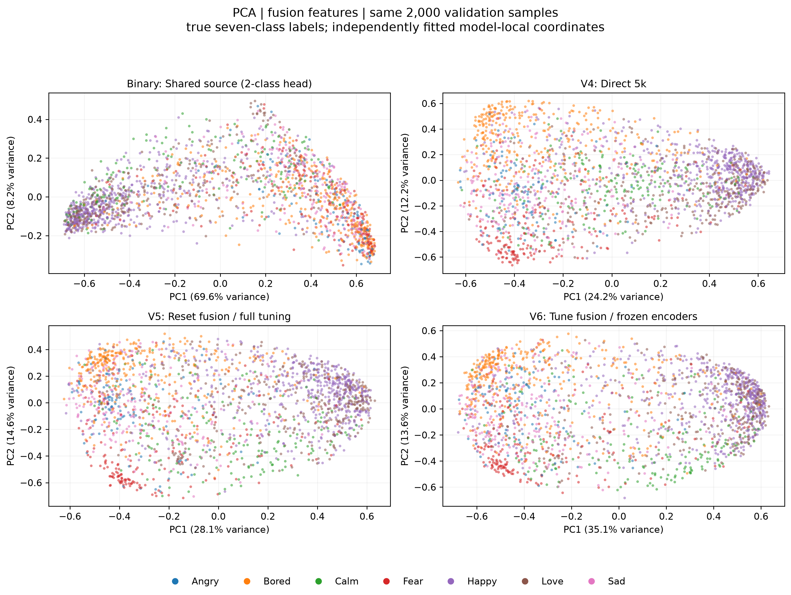
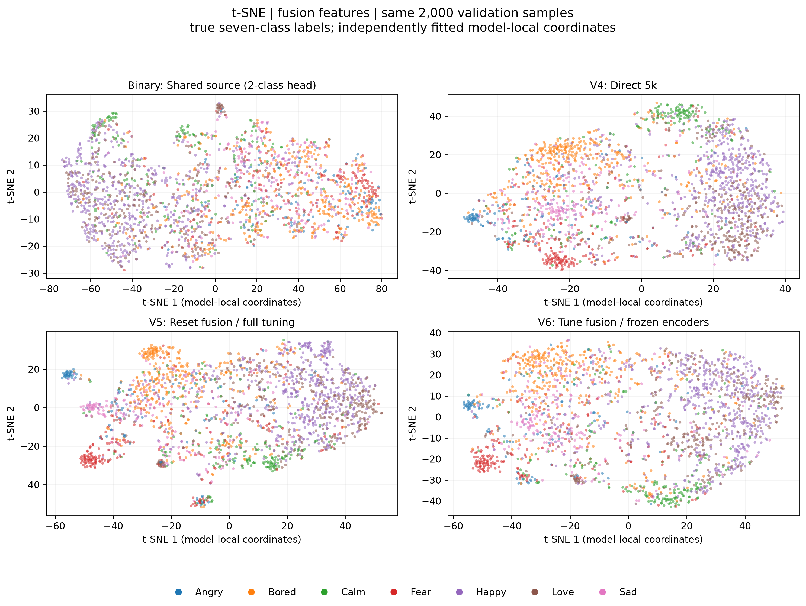
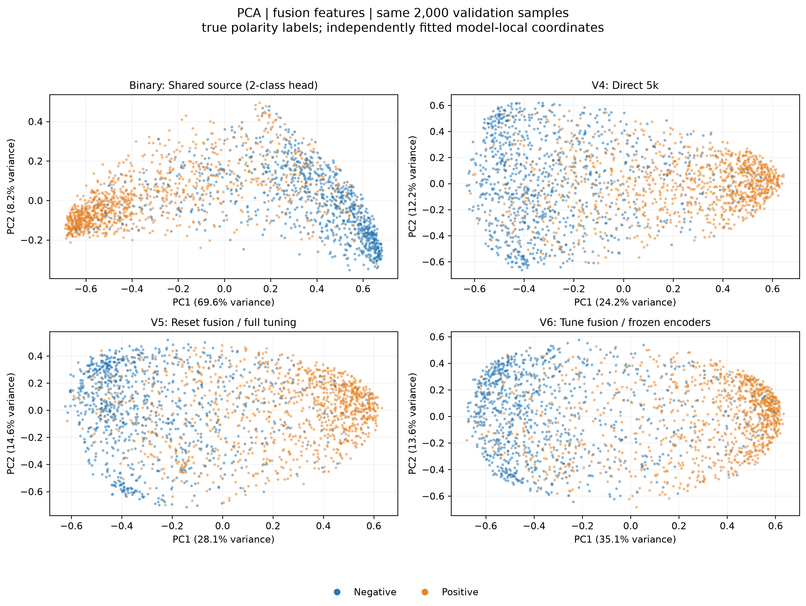
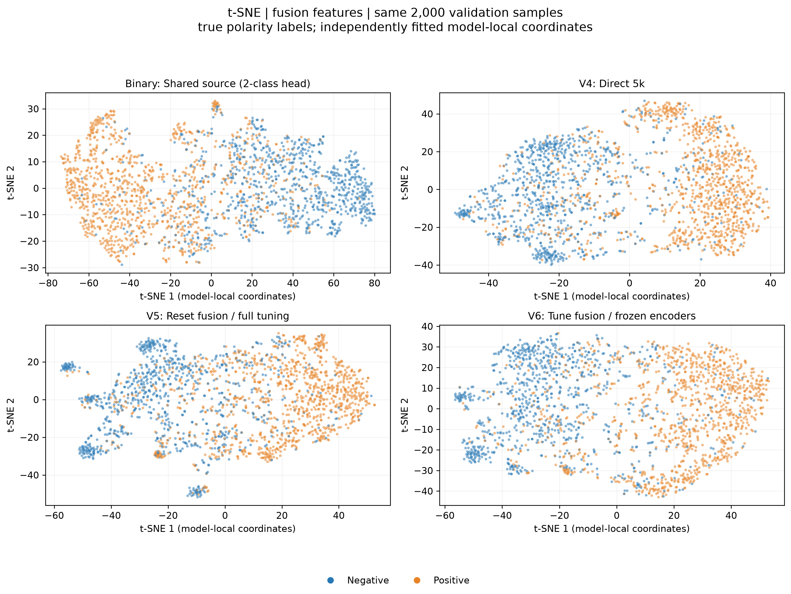
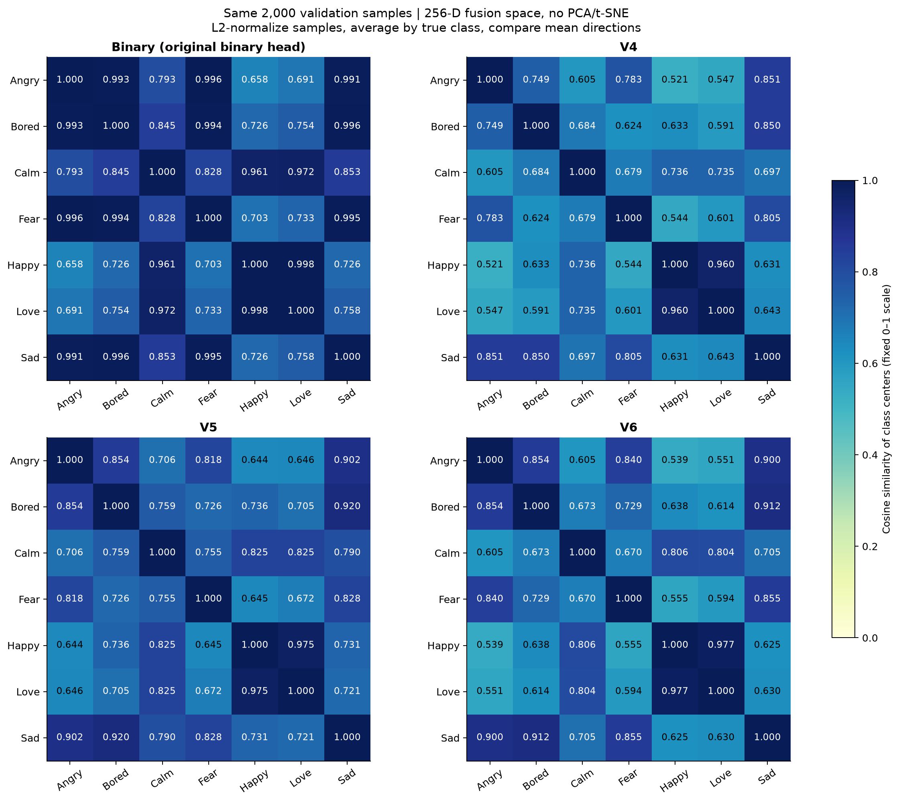

# Binary、V4、V5、V6的特征可视化：PCA、t-SNE与类中心

实验日期：2026-10-24，Asia/Singapore。本报告与[六版本监督实验及Qwen评估](experiment_review.md)并列，单独展示已有checkpoint的融合特征。此次仅提取特征和降维绘图，没有训练新模型、训练分类探针或搜索可视化参数。

在相同2,000条validation上，共享二分类源模型的融合表示呈现明显的正负情绪主方向；V4/V5/V6出现更多由细类占主导的局部区域，但类别之间仍有大量重叠。以下结论均为这次二维投影中的描述，不能据此证明信息被永久丢失、负迁移的因果机制或模型性能排名。

## 模型与checkpoint

下列路径相对于作者原训练目录 `TumEmo_Binary_Training_Handoff/runs_comparison/`。代码仓库复现训练时，对应输出根目录为 `training/runs_comparison/`；新的源模型目录指纹可能不同。

| 图中名称 | Checkpoint相对路径 | 选中epoch | 含义 |
|---|---|---:|---|
| Binary | `shared_binary/e1555ba804919d21/seed_42/best.pt` | 3 | 源20k二分类模型，按验证macro-F1选模 |
| V4 | `direct_5k/seed_42/best.pt` | 8 | 目标5k直接七分类，全参数训练 |
| V5 | `reset_fusion/seed_42/best.pt` | 4 | 继承源编码器，重置融合层，再做5k全参数微调 |
| V6 | `tune_fusion/seed_42/best.pt` | 4 | 继承并冻结源编码器，5k训练融合层与新分类头 |

Binary保留原来的2类分类头；其七类图的颜色来自样本真实标签，不代表源模型具有七分类输出。V5/V6配置中的源checkpoint SHA-256均与所选Binary一致：`a098806de821c9d0fde3d90399fa5ef4de06fff4b9c774de6495a97b0d18ee53`。四份权重完整哈希及元数据见[提取核验记录](data/embedding_visualization.json)。所有原checkpoint保持不变，GitHub不分发权重。

## 同一数据与特征定义

使用原实验固定validation的全部2,000条样本，四个模型的样本ID、顺序、七类标签、原图哈希、处理后的图像及清洗文本指纹一致。类别数量为：Angry 116、Bored 356、Calm 187、Fear 215、Happy 557、Love 346、Sad 223。

图像处理复现原实验的224×224等比例填充、JPEG quality=95保存/重读及ImageNet归一化；文本沿用URL与情绪hashtag清洗、固定revision的RoBERTa tokenizer和96-token上限。用eval模式和 `torch.inference_mode()` 在H200 NVL上提取FP32特征，batch16。

特征位置为：**ViT图像768维 + RoBERTa文本768维 → 拼接1536维 → Linear / LayerNorm / ReLU → 256维融合表示**，位于dropout和分类头之前。此次没有提取可选的1536维encoded特征，因此观察直接针对融合表示，不能单独定位图像或文本编码器的贡献。

重新前向计算的指标与checkpoint中保存的验证指标完全一致：

| 模型 | 指标任务 | Validation accuracy | Validation macro-F1 | 复现检查 |
|---|---|---:|---:|---|
| Binary | 二分类 | 81.75% | 0.816956 | 通过 |
| V4 | 七分类 | 56.50% | 0.542389 | 通过 |
| V5 | 七分类 | 54.80% | 0.517813 | 通过 |
| V6 | 七分类 | 56.30% | 0.534014 | 通过 |

这张表仅用于确认模型和输入还原正确；二分类指标不与七分类指标排名。这些模型均曾用validation选模，图中集合也不是新的独立测试集。

## 投影设置

每条256维特征先做L2归一化，再对四个模型分别拟合投影：PCA直接降至2维；t-SNE先PCA至50维，再以perplexity=30、1500 iterations、PCA初始化、Euclidean距离、learning_rate=auto、seed42降至2维。使用numpy 2.2.6、scikit-learn 1.7.2、matplotlib 3.11.2。

每个模型的七类图与正负情绪图复用完全相同的坐标，只改变颜色。正类为Calm/Happy/Love，共1,090条；负类为Angry/Bored/Fear/Sad，共910条。所有面板采用相同的类别颜色及固定随机点绘制顺序，减少固定类别覆盖其他类别的问题。

L2归一化去除了特征幅度差异。不同模型独立拟合，所以左右方向、旋转、坐标大小、簇间距离和空白区域不能直接跨面板比较；t-SNE中的岛状分布也不等价于原高维空间中的独立类别。类别数量沿用原validation而没有重采样，点的密度也受类别样本数影响。

## PCA：七类着色



[下载PCA七类PDF](figures/embedding/fusion_pca_seven.pdf)

| 模型 | PC1解释方差 | PC2解释方差 | 前两维合计 |
|---|---:|---:|---:|
| Binary | 69.57% | 8.15% | 77.73% |
| V4 | 24.16% | 12.20% | 36.36% |
| V5 | 28.09% | 14.55% | 42.64% |
| V6 | 35.12% | 13.64% | 48.76% |

Binary的方差主要集中在第一主成分；结合后面的极性着色，可以观察到这一方向两端分别由正、负情绪主导。七类着色下，Happy与Love明显交织，负向细类也未形成七个清晰分离的区域。

V4/V5/V6在本次投影中呈现更多局部类别偏聚，例如Bored、Fear的部分样本形成较集中的区域，但中间区域依然混合。它们的第一主成分占比较低，只说明归一化后方差分布更分散，不能解释为“低占比就是更好的模型”。三者前两维仅保留36%–49%的方差，二维图没有展示剩余的大部分变化。

## t-SNE：七类着色



[下载t-SNE七类PDF](figures/embedding/fusion_tsne_seven.pdf)

在此固定投影设置下：

- **Binary：** 整体仍以粗粒度结构为主，同一极性中的多种情绪广泛混合；局部也存在某些类别富集，不能据此说源模型完全没有细类信息。
- **V4：** 能看到由Bored、Fear、Angry、Calm部分样本占主导的局部区域；Happy和Love仍有大范围重叠，Sad散布在多个混合区域。
- **V5：** 有若干局部类别聚集，但仍存在明显混合。不能因为局部看起来更紧凑，就断言它优于V4；既有验证accuracy也未显示这样的排序。
- **V6：** 冻结编码器后，只训练融合层和分类头，仍能呈现细类占主导的局部区域。这与“融合层可以重新组织已有源编码器特征”的解释相容，但该图本身不构成因果证明。

V4/V5/V6没有形成七个完全分离的簇。本报告不据图对三者做新的优劣排名，也不使用t-SNE的KL值当作分类质量分数。

## 相同坐标改按正负情绪着色





[下载PCA正负PDF](figures/embedding/fusion_pca_binary.pdf) · [下载t-SNE正负PDF](figures/embedding/fusion_tsne_binary.pdf)

四个模型都保留了明显的极性结构，同时存在两种颜色交叉的区域。源模型的粗粒度方向最直观，但这不意味着它在七分类上更强。对照七类图可看到：一些在极性图中较单一的区域，实际上包含多个同极性的情绪类别。正负情绪分得开，与七种细类分得开，是不同的观察目标。

## 七个类中心的相似度：直接查看256维融合空间



[下载类中心相似度PDF](figures/embedding/fusion_centroid_similarity.pdf)

这张图直接使用相同2,000条validation的原始256维融合特征，**不使用PCA或t-SNE坐标**。每条特征先做L2归一化，按真实七类求均值，再对七个均值计算余弦相似度。Binary仍保留二分类头，只用七类真实标签分组求均值，没有训练七分类探针。四个面板统一使用0–1色标，对角线恒为1。

| 模型 | Happy–Love | 同极性不同类别平均相似度 | 跨极性类别平均相似度 |
|---|---:|---:|---:|
| Binary | 0.9981 | 0.9885 | 0.7556 |
| V4 | 0.9603 | 0.7881 | 0.6148 |
| V5 | 0.9749 | 0.8526 | 0.7092 |
| V6 | 0.9771 | 0.8530 | 0.6166 |

平均值按不重复类别对等权计算，排除对角线：同极性共9对，跨极性共12对；不是按样本数加权。完整数值保留在[矩阵CSV](data/fusion_centroid_similarity.csv)与[定义及汇总JSON](data/fusion_centroid_similarity.json)。

Binary中同极性类别的中心方向非常接近；Happy–Love为0.9981，Angry–Fear为0.9965。这与二分类目标下的粗粒度结构相符，但不等于每个样本完全重叠或细分类信息不可恢复。V4/V5/V6中，同极性类别中心的平均相似度均低于Binary；V6冻结源编码器后仍发生这一变化，与融合层能够改变类别表示的观察一致。

Happy–Love是四个模型中相似度最高的非对角类别对，直接补充了散点图中二者混合的现象。V4这一对为0.9603，V5/V6约0.975/0.977，仍很接近；仅凭这些数值不能推导分类accuracy或判断预测时的混淆方向。

**解释边界：** 特征位于ReLU之后，全部非负，共同方向本身就会抬高余弦值；本分析没有做全局中心化。类中心也会掩盖同类内部的分散与多峰结构。均值方向不同不等于分布完全分离，余弦较低不等于模型更准确。JSON同时保留各类“单位特征均值的长度”以描述集中程度，但本报告不把它或类间余弦作为新的性能排名指标。

## 文件与复现

本报告包含四张PCA/t-SNE对照图和一张四模型类中心相似度图，每张同时保存PNG和PDF。二维坐标和设置随报告提供：

- [Binary坐标](figures/embedding/Binary_fusion_coordinates.csv)、[V4坐标](figures/embedding/V4_fusion_coordinates.csv)、[V5坐标](figures/embedding/V5_fusion_coordinates.csv)、[V6坐标](figures/embedding/V6_fusion_coordinates.csv)：每份2,000行，与固定validation ID和顺序一致。
- [投影设置](figures/embedding/projection_settings.json)：记录投影超参数、软件版本、解释方差及checkpoint来源。
- [提取核验记录](data/embedding_visualization.json)：记录指标复现、输入指纹、源checkpoint关系和特征文件哈希。
- [类中心矩阵](data/fusion_centroid_similarity.csv)及[汇总JSON](data/fusion_centroid_similarity.json)：4×7×7个相似度、类内集中程度和checkpoint哈希。

原始特征NPZ及逐模型JSON保存在本机 `embedding_analysis/results/features/`，没有上传GitHub；代码、图表、二维坐标和分析报告已纳入发布范围。NPZ不包含模型权重或原始图片/文本，可在有需要时单独使用；公开二维坐标可以复核散点位置，但不能代替高维特征重新拟合PCA/t-SNE。

在已准备数据并生成对应checkpoint的仓库中，运行：

```bash
python -m embedding_analysis \
  --data data/subset_50000.zip \
  --runs-root training/runs_comparison
```

若源模型目录存在多个候选，使用明确路径：

```bash
python -m embedding_analysis \
  --data /path/to/subset_50000.zip \
  --checkpoint Binary=/path/to/runs_comparison/shared_binary/e1555ba804919d21/seed_42/best.pt \
  --checkpoint V4=/path/to/runs_comparison/direct_5k/seed_42/best.pt \
  --checkpoint V5=/path/to/runs_comparison/reset_fusion/seed_42/best.pt \
  --checkpoint V6=/path/to/runs_comparison/tune_fusion/seed_42/best.pt
```

详见[模块说明](../embedding_analysis/README.md)。默认输出到 `embedding_analysis/results/`，不会覆盖本报告。提取和绘图均会检查指标及样本一致性；不同来源、标签顺序或验证复现失败的文件会被拒绝。新增4项针对性测试通过，涵盖二分类标签映射、源模型歧义、验证复现失败及绘图样本错位。

本次类中心图复用已提取的同一批NPZ，未增加推理或训练；生成命令和额外核验见[数据与模型可视化复现说明](../docs/report_visualizations.md)。
