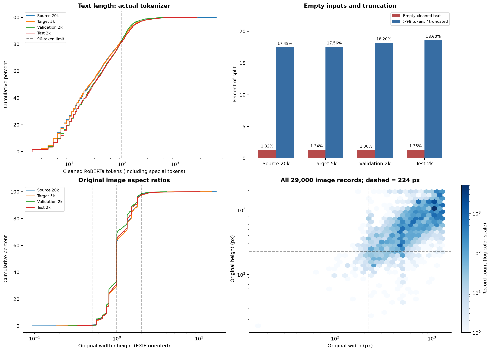
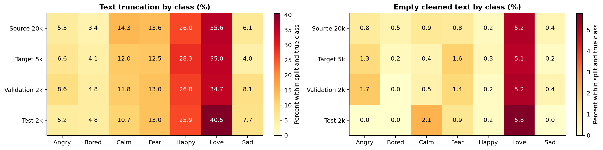
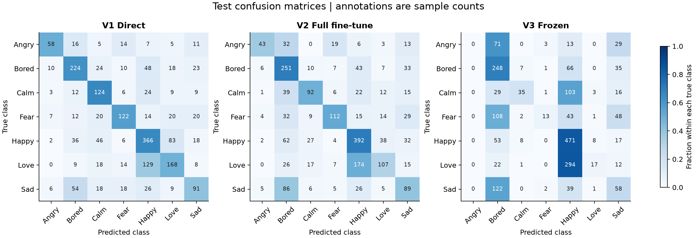
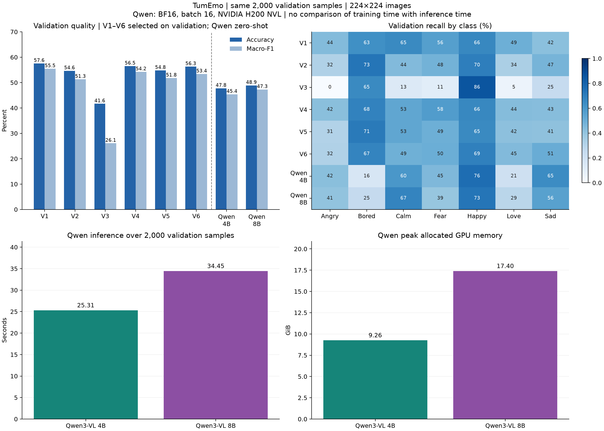
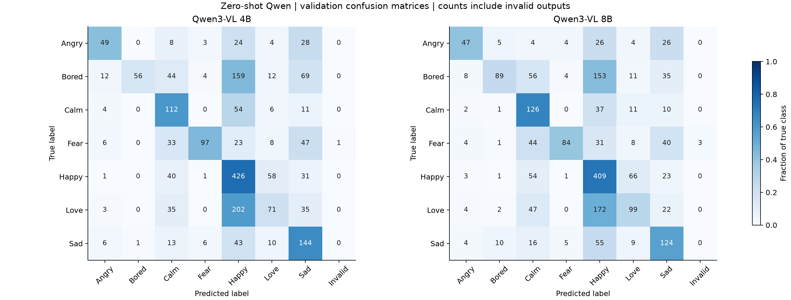
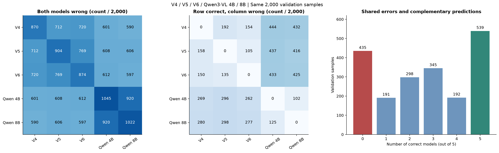
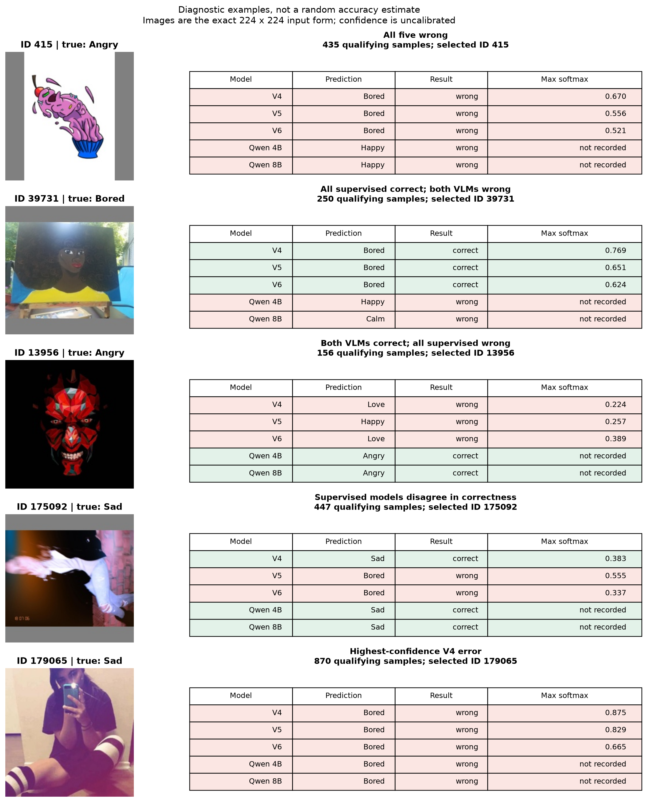

# 六版本监督实验与Qwen零样本评估

另见并列的[数据集报告](dataset_review.md)（类别占比、原始样本与预处理对照）和[Binary/V4/V5/V6特征可视化报告](embedding_visualization.md)（PCA/t-SNE、类中心相似度）。本页开头展示输入质量，末尾展示同一validation上的模型错误对照。

实验日期：2026-10-24，Asia/Singapore。原V1→V2→V3队列约16:23–17:09；V4随后独立补跑，V5→V6于19:38–19:47在相同GPU上串行补跑。原六个监督方案使用ViT-B/16 + RoBERTa-base、seed42、同一NVIDIA H200 NVL、batch16与FP32。依据为W&B live API和本地结果，七个训练run均为finished，关键summary与逐epoch指标已核对一致（允许浮点序列化舍入误差）。同日新增两个Qwen零样本validation评估run，结果单独列于后文；均未覆盖历史模型和结果。

## 输入质量与预处理影响

以下统计覆盖本次实际使用的29,000条记录：Source 20k、Target 5k、Validation 2k、Test 2k。重新读取原始ZIP，核验数据包、清单指纹、每条原图哈希和清洗文本，结果与原训练缓存及既有审计一致。这里只补充描述性分析，没有根据test统计修改训练或选择可视化参数。

[下载输入质量PDF](figures/dataset/input_quality.pdf)

| 划分 | 样本数 | 清洗后空文本 | 超过96 tokens | 清洗后token数中位数 / P95 | 极端图片宽高比 |
|---|---:|---:|---:|---:|---:|
| Source | 20,000 | 264（1.32%） | 3,496（17.48%） | 25 / 176 | 498（2.49%） |
| Target | 5,000 | 67（1.34%） | 878（17.56%） | 25 / 175 | 144（2.88%） |
| Validation | 2,000 | 26（1.30%） | 364（18.20%） | 29 / 158.05 | 33（1.65%） |
| Test | 2,000 | 27（1.35%） | 372（18.60%） | 29 / 185 | 54（2.70%） |

token数由原训练固定revision的RoBERTa tokenizer计算，包含首尾特殊token，不是单词数。清洗后总数大于96才会截断，validation的364条与此前Qwen输入限制记录一致。空文本仍产生特殊token；Qwen看到的是相同RoBERTa截断边界对应的文本前缀，表中数值不是Qwen自身tokenizer的长度。

“极端宽高比”定义为EXIF校正后的 `width/height < 0.5` 或 `> 2`。图像尺寸图统计原图，所有实际输入仍为224×224等比例填充的JPEG。Source/Target分别只有78/16条原图长边小于224，Validation/Test为2/3条；多数图像会缩小，有些文字细节可能随之变得难读。尺寸和截断统计本身不能量化这种变化造成了多少准确率损失。

[下载分标签质量PDF](figures/dataset/input_quality_by_label.pdf)

输入问题并非均匀分布在七个类别中：Target的Love有309/883条（35.00%）被截断、45/883条（5.10%）清洗为空；Happy截断365/1290条（28.29%）。Validation的Love截断120/346条（34.68%）、空文本18/346条（5.20%）。这提示分析Love/Happy的混淆时应关注文本长度与可用信息，但不能据此认定截断导致了它们的全部错误。

Source与Target的总体长度、空文本和截断比例接近。当前结果不支持仅用这几个总体统计解释V2/V5与V4的效果差异。各模型沿用相同预处理；改变截断长度或图像分辨率需要单独对照实验，本次没有进行此类修改。完整[数值CSV](data/input_quality.csv)、[分组统计JSON](data/dataset_visualization.json)与[数据集报告](dataset_review.md)可用于复核。

## 配置与比较关系

| 方案 | 数据和初始化 | 七分类更新范围 |
|---|---|---|
| V1 | 通用预训练编码器 → 源20k + 目标5k直接七分类 | 全参数 |
| V2 | 通用预训练编码器 → 源20k二分类 → 目标5k七分类 | 全参数 |
| V3 | 与V2相同二分类checkpoint → 目标5k七分类 | 只训练新头；冻结两个编码器和融合层 |
| V4 | 通用预训练编码器 → 目标5k直接七分类 | 全参数；不加载二分类checkpoint |
| V5 | 同一源二分类编码器 → 全新融合层及七分类头 → 目标5k | 全参数 |
| V6 | 同一源二分类编码器和融合层 → 新七分类头 → 目标5k | 冻结编码器，更新融合层及头 |

V4只使用原来的finetune_5000清单；验证2k/测试2k、划分seed、预处理、优化器、学习率、最大20轮、patience4、验证accuracy选模均保持一致。它与V2七分类阶段的样本指纹及计划步数完全相同。V4未训练源20k，但为了保持评估样本一致，仍沿用按全部25k排重后的验证/测试集。详细参数见[实验协议](../docs/experiment_protocol.md)。

## 实际结果

| 方案 | W&B run | 完成轮数 / 最佳轮数 | 验证accuracy | 测试accuracy | 测试macro-F1 |
|---|---|---:|---:|---:|---:|
| V1 Direct 25k | [4ad537dc9c04](https://forge.coreweave.com/wandb/ql2505-columbia-university/tumemo-training-comparison/runs/4ad537dc9c04) | 6 / 2 | 57.55% | 57.65% | 0.5641 |
| V2 整体微调 | [76d6899c9fde](https://forge.coreweave.com/wandb/ql2505-columbia-university/tumemo-training-comparison/runs/76d6899c9fde) | 6 / 2 | 54.65% | 54.30% | 0.5162 |
| V3 冻结主干 | [ff4274c39758](https://forge.coreweave.com/wandb/ql2505-columbia-university/tumemo-training-comparison/runs/ff4274c39758) | 20 / 18 | 41.65% | 42.10% | 0.2633 |
| V4 Direct 5k | [91fae8eb7f88](https://forge.coreweave.com/wandb/ql2505-columbia-university/tumemo-training-comparison/runs/91fae8eb7f88) | 12 / 8 | 56.50% | 56.90% | 0.5484 |
| V5 Reset fusion | [2214987ad17a](https://forge.coreweave.com/wandb/ql2505-columbia-university/tumemo-training-comparison/runs/2214987ad17a) | 8 / 4 | 54.80% | 54.85% | 0.5283 |
| V6 Tune fusion | [dd4a5a95db85](https://forge.coreweave.com/wandb/ql2505-columbia-university/tumemo-training-comparison/runs/dd4a5a95db85) | 8 / 4 | 56.30% | 54.75% | 0.5276 |
| 共享二分类源模型 | [de36b9bb0303](https://forge.coreweave.com/wandb/ql2505-columbia-university/tumemo-training-comparison/runs/de36b9bb0303) | 7 / 3 | 81.75% | 未做独立二分类测试 | 验证F1 0.8170 |

本次测试accuracy最高的是V1 Direct 25k，完整方案阶段耗时最短的是V4 Direct 5k。二分类81.75%与七分类指标属于不同任务，不直接横向排名。

新增V4测试accuracy为 **56.90%**，macro-F1为 **0.5484**。V2相对V4的accuracy差为 **-2.60个百分点**，同一2,000样本测试集上相差 **-52次**正确预测；V2完整方案耗时是V4的 **2.43倍**。该对照用于衡量增加源二分类预训练的实际收益与成本，不代表两者拥有相同总监督或总计算预算。

V1比V4的accuracy高 **0.75个百分点**，但额外使用20k七分类标签，同epoch下也有更多优化步数。V1比V2高3.35个百分点、V2比V3高12.20个百分点；这些单seed差异均不能直接推广为普遍规律。

本次V4相对V1完整阶段耗时减少 **51.36%**，相对V2减少 **58.91%**。在这组默认配置和seed下，V4提供了较好的准确率与总成本折中；V2增加的源二分类训练没有带来更高的最终测试accuracy。该结果只支持本次配置下的观察，不能证明所有二分类预训练都无效。

## 效率：完整方案与5k七分类阶段

| 方案 | 完整训练循环时间 | 完整方案阶段耗时 | 七分类阶段训练时间 | 七分类阶段总耗时 |
|---|---:|---:|---:|---:|
| V1 Direct 25k | 995.80秒 | 1064.39秒（17.74分） | 995.80秒 | 1064.39秒 |
| V2 整体微调 | 1121.29秒 | 1259.78秒（21.00分） | 198.40秒 | 267.23秒 |
| V3 冻结主干 | 1183.00秒 | 1393.32秒（23.22分） | 260.11秒 | 400.77秒 |
| V4 Direct 5k | 397.36秒 | 517.70秒（8.63分） | 397.36秒 | 517.70秒 |
| V5 Reset fusion | 1188.22秒 | 1344.41秒（22.41分） | 265.33秒 | 351.86秒 |
| V6 Tune fusion | 1026.51秒 | 1160.42秒（19.34分） | 103.62秒 | 167.87秒 |

共享二分类训练922.89秒、阶段总耗时992.55秒，V2/V3/V5/V6完整成本均计入它；实际只训练一次。V4没有二分类阶段，因此自身七分类阶段即完整训练方案。V4的W&B `comparison/stage2_*`为null，这是正确的阶段语义；下表使用V4的 `efficiency/*` 与V2/V3第二阶段对照。

| 指标 | V2第二阶段 | V3第二阶段 | V4全部训练 | V5第二阶段 | V6第二阶段 |
|---|---:|---:|---:|---:|---:|
| 训练样本 | 5,000 | 5,000 | 5,000 | 5,000 | 5,000 |
| 实际epoch / 最佳epoch | 6 / 2 | 20 / 18 | 12 / 8 | 8 / 4 | 8 / 4 |
| 优化器步数 | 1878 | 6260 | 3756 | 2504 | 2504 |
| 平均每轮训练循环 | 33.07秒 | 13.01秒 | 33.11秒 | 33.17秒 | 12.95秒 |
| 平均每轮含验证/保存 | 42.31秒 | 19.39秒 | 42.24秒 | 42.27秒 | 19.26秒 |
| 平均每步 | 105.65毫秒 | 41.55毫秒 | 105.79毫秒 | 105.96毫秒 | 41.38毫秒 |
| 吞吐量 | 151.21样本/秒 | 384.45样本/秒 | 151.00样本/秒 | 150.75样本/秒 | 386.02样本/秒 |
| 峰值allocated GPU显存 | 5.232 GiB | 0.974 GiB | 5.231 GiB | 5.231 GiB | 0.980 GiB |
| 可训练参数 | 210,249,479 | 1,799 | 210,249,479 | 210,249,479 | 395,783 |
| 总验证耗时 | 30.41秒 | 101.39秒 | 61.17秒 | 40.14秒 | 39.91秒 |
| 总checkpoint保存耗时 | 25.07秒 | 26.24秒 | 48.38秒 | 32.71秒 | 10.59秒 |

冻结后的V3吞吐量为V2的2.54倍、第二阶段显存少81.39%，但20轮对6轮使总训练时间增加31.10%、阶段总耗时增加49.97%。V3完整方案峰值显存仍约5.23 GiB，因为源二分类阶段是全参数训练。已有源模型时，V2新增阶段只需267.23秒；从零执行完整方案时应计入源训练成本。

V4与V2的每轮训练约33秒、吞吐量约151样本/秒，单位训练成本接近。但V4运行12轮，V2第二阶段运行6轮，因此V4七分类阶段耗时是V2第二阶段的 **1.94倍**。这与V4完整方案更快并不矛盾：它省去了992.55秒的源二分类阶段。

`train_seconds`包含数据读取、前向、反向、优化和定期日志；阶段总耗时还包含模型设置、验证、checkpoint保存和最终测试，不含外部预处理和W&B最后上传等待。进程启动、缓存检查与外部哈希核验不计入阶段计时。V4/V5/V6是稍后补跑，虽然设备与配置相同，计时仍可能受系统状态影响。

## 新增融合层消融：只改变一个因素

原V4编号、数据和run保持不变。V5对照V2：相同源编码器与全参数微调，仅将融合层重置；V6对照V3：相同源编码器和融合层，仅解除融合层冻结。四个迁移版本加载同一个第3轮二分类best.pt，5k样本指纹、验证/测试、seed、学习率、调度器、patience、框架版本和GPU均一致。各七分类阶段的新头初始化规则相同。

V5 Reset fusion：最佳第4轮，共8轮，测试accuracy 54.85%、macro-F1 0.5283；相对V2 整体微调变化 **+0.55个百分点**。第二阶段351.86秒（5.86分），计入源训练后完整成本22.41分。

V6 Tune fusion：最佳第4轮，共8轮，测试accuracy 54.75%、macro-F1 0.5276；相对V3 冻结主干变化 **+12.65个百分点**。第二阶段167.87秒（2.80分），计入源训练后完整成本19.34分。

V5相对V2的改善为0.55个百分点（11个测试样本），仍低于V4，且增加了第二阶段耗时；单seed不足以断言重新初始化融合层具有稳定收益。V6相对V3提升12.65个百分点，说明保持源编码器不变、允许融合层适应，已经能明显改善这次运行中的细分类表现。这不支持“源编码器已经不可逆地丢失全部细分类信息”的解释，但仍不能定位所有性能差距的唯一原因。

V6与V2的测试accuracy分别为54.75%和54.30%，第二阶段耗时从267.23秒减少到167.87秒，减少37.18%；显存从5.232 GiB降至0.980 GiB。V6与V5仅差0.10个百分点（2个测试样本），但第二阶段耗时不到V5的一半。这些小幅准确率差异未通过统计显著性检验。若已持有源二分类模型，V6在本次实验中提供了较好的适应成本；若从通用预训练权重开始计算整个方案，V4仍更快且测试accuracy更高。

保存后的V6最佳及最后checkpoint中，两个编码器的全部张量均与源模型逐项相等，而融合层权重已改变；V5的编码器发生更新。配置、云端指标和权重检查见[审计记录](data/fusion_audit.json)。这些检查确认实现符合设计，不替代多seed统计验证。

## 收敛与类别表现

V4第8轮达到最佳验证accuracy 56.50%，累计训练264.97秒；最终运行12轮。连续4轮未严格提升后早停。 最终测试只使用该验证选出的best.pt。测试结果不用于选择epoch或调整本次超参数。

V1第2轮最佳，之后训练loss与验证loss一同回升，不能简单解释为典型过拟合。V2第2轮最佳，后续训练loss下降但验证收益停滞。V3第18轮首次达到最佳，第20轮仅持平，best.pt仍保留第18轮。六版七分类都未达到配置中的80%验证accuracy目标，达标时间为null。

| 测试召回率 | V1 | V2 | V3 | V4 | V5 | V6 |
|---|---:|---:|---:|---:|---:|---:|
| Angry | 50.00% | 37.07% | 0.00% | 42.24% | 37.07% | 36.21% |
| Bored | 62.75% | 70.31% | 69.47% | 66.11% | 73.39% | 66.67% |
| Calm | 66.31% | 49.20% | 18.72% | 54.55% | 56.68% | 49.73% |
| Fear | 56.74% | 52.09% | 6.05% | 63.72% | 50.23% | 53.95% |
| Happy | 65.71% | 70.38% | 84.56% | 67.50% | 63.55% | 66.97% |
| Love | 48.55% | 30.92% | 4.91% | 46.24% | 38.44% | 38.44% |
| Sad | 40.99% | 40.09% | 26.13% | 35.14% | 40.99% | 45.05% |

V3从未预测Angry，把84.1%的样本预测成Happy或Bored，说明accuracy掩盖了多个细类失效。把已有七分类混淆矩阵合并成正/负两组，原V1/V2/V3分别为83.15%/82.35%/83.90%；这是七分类预测的事后聚合，**不是共享二分类checkpoint的独立测试**。它与“粗粒度特征仍有用、细粒度区分不足”的解释相符，但不能定位到某一个编码器或融合层。

## Qwen零样本七分类：同一2,000条validation

新增 **Qwen3-VL-4B-Instruct** 和 **Qwen3-VL-8B-Instruct**，均直接用通用模型做七分类，没有任务微调、示例提示或提示词搜索。两者沿用同一validation清单、224×224缓存图片和清洗后文本；文本限制到原RoBERTa `max_length=96`对应的前缀，2,000条中364条被截断。固定相同英文提示词、greedy生成、最多16个新token；模型revision、输入指纹及完整协议见[复现说明](../docs/vlm_validation.md)。

**此节所有accuracy和macro-F1均来自validation，不是前文的test。** V1–V6曾在这份validation上选择最佳epoch，而Qwen未在该集合上训练或调整提示词；表格用于描述同一集合上的表现，不能视为独立test排名或相同训练预算对照。

| 模型 | 本任务适应方式 | Validation accuracy | Validation macro-F1 |
|---|---|---:|---:|
| V1 Direct 25k | 25k七分类监督，验证选模 | **57.55%** | **0.5547** |
| V2 Full | 20k二分类→5k全参数微调，验证选模 | 54.65% | 0.5128 |
| V3 Frozen | 20k二分类→5k仅训练头，验证选模 | 41.65% | 0.2608 |
| V4 Direct 5k | 5k七分类监督，验证选模 | 56.50% | 0.5424 |
| V5 Reset fusion | 20k二分类→重置融合层后5k微调，验证选模 | 54.80% | 0.5178 |
| V6 Tune fusion | 20k二分类→5k训练融合层和头，验证选模 | 56.30% | 0.5340 |
| [Qwen3-VL 4B](https://forge.coreweave.com/wandb/ql2505-columbia-university/tumemo-training-comparison/runs/bd4f6eae9e94) | 零样本 | 47.75%（955/2,000） | 0.4538 |
| [Qwen3-VL 8B](https://forge.coreweave.com/wandb/ql2505-columbia-university/tumemo-training-comparison/runs/faa86c57aec0) | 零样本 | 48.90%（978/2,000） | 0.4728 |

8B相对4B提高1.15个百分点，多答对23条；macro-F1提高0.0191。两者优于本次V3冻结头方案，但低于其余五个监督方案。8B相对V1低8.65个百分点、相对V4低7.60个百分点。当前结果只支持这套零样本提示和受控输入下的观察，不能推断VLM经过微调、高分辨率输入或其他提示设置后仍有同样排序。

### Qwen推理效率

两者在同一H200 NVL GPU 0上串行运行，batch16、BF16、SDPA，无量化。下表是推理成本，**不能与前文的训练时间直接比较**。

| 指标 | Qwen3-VL 4B | Qwen3-VL 8B |
|---|---:|---:|
| 实际参数数 | 4,437,815,808 | 8,767,123,696 |
| 2,000条推理耗时 | 25.31秒 | 34.45秒 |
| 吞吐量 | 79.03样本/秒 | 58.06样本/秒 |
| batch吞吐折算每样本耗时 | 12.65毫秒 | 17.22毫秒 |
| 峰值allocated显存 | 9.26 GiB | 17.40 GiB |
| 本地缓存权重加载 | 2.18秒 | 3.62秒 |
| 合成输入预热 | 1.23秒 | 0.75秒 |
| 无效输出（已计错） | 1（0.05%） | 3（0.15%） |

8B耗时增加36.12%，峰值allocated显存增加87.88%，获得上述1.15个百分点的accuracy提升。推理耗时包含图像读取、processor、设备传输、生成和解码，排除模型下载/加载、预热、结果写盘和W&B同步；折算每样本耗时不是单请求延迟。每种规模只完整测量一次，不能视为跨硬件或重复运行的稳定性能界限。

### 类别差异与解释边界

| Validation召回率 | Qwen3-VL 4B | Qwen3-VL 8B |
|---|---:|---:|
| Angry | 42.24% | 40.52% |
| Bored | 15.73% | 25.00% |
| Calm | 59.89% | 67.38% |
| Fear | 45.12% | 39.07% |
| Happy | 76.48% | 73.43% |
| Love | 20.52% | 28.61% |
| Sad | 64.57% | 55.61% |

主要不足集中在Bored和Love。真实Bored有356条，4B/8B只分别预测57/109条为Bored；真实Love有346条，其中202/172条被预测为Happy。两者分别把931/883条预测为Happy，而真实Happy为557条。8B对Bored、Calm、Love的召回更好，但并非每个类别都提升。

这些分布说明通用零样本情绪判断与本数据集的七类标注存在偏差，但不足以区分标签语义、领域分布、提示方式和图像分辨率各自的因果贡献。224×224限制控制了与原模型的视觉信息量，也限制了VLM使用高分辨率细节；未审计Qwen通用预训练语料与本数据的重叠。当前没有通过查看结果后修改提示词来提高该validation分数。

两次评估均完整保存2,000条预测，重新计算指标后与本地汇总一致，并核对W&B的finished状态、summary、模型revision及输入指纹。参见[聚合JSON](data/vlm_validation.json)、[对比CSV](data/vlm_validation.csv)、[逐样本标签预测](data/vlm_predictions.csv)和[云端核验记录](data/vlm_wandb_verification.json)。公开预测仅含样本ID、真实标签和预测标签，不含原始图片或文本。

## 结论边界与文件

- V4补齐了“仅有5k七分类标签、不先做源二分类训练”的基线；与V2比较时同时看最终质量、5k阶段成本和完整方案成本。
- V1使用额外20k细类标签。相同epoch上限不等于相同训练步数或计算预算；本实验不是固定算力消融。
- 六版监督实验当前只有seed42，未做多seed显著性检验，历史test评估未保留逐样本预测。后续特征提取保留了V4/V5/V6的validation概率，本报告末尾将它们与Qwen逐样本validation预测对齐分析；这不等于补齐独立test配对检验。V4是在已查看前三版测试结果后提出的补充基线，但其训练超参数保持原值；如继续根据这些结果优化方案，应使用新的独立最终评估。
- 源/目标清单仍共有227个图片哈希；验证/测试已排除精确图片和规范化非空文本重复，但没有完整近重复或跨用户审计。

所有21个checkpoint的历史对应关系见[文件索引](checkpoints.md)。完整指标见[聚合JSON](data/seed42.json)和[CSV](comparison.csv)，训练图表用 `python tools/plot_results.py` 重绘。GitHub发布代码、分析材料及报告中的少量样本缩略图/文本节选，不包含checkpoint或完整原始数据；获取相同数据后可按[复现指南](../docs/reproduction.md)重新训练。

## 模型错误对照：同一validation上的共同错误与分歧

比较V4、V5、V6与Qwen3-VL 4B/8B。监督预测来自已经核验的特征NPZ中的七分类概率，Qwen预测来自既有逐样本CSV；没有重新训练、修改模型或重新运行Qwen。按ID核对全部2,000条真实标签，重新计算五个模型的accuracy/macro-F1，与前文validation结果一致。Qwen的1/3条Invalid仍计错，未被排除。

**以下全部是validation分析，不是前文test结果。** 监督模型曾在此集合选模，Qwen未在此集合调整提示；这些差异用于描述当前运行的错误模式。共享源模型只有二分类头，因此不混入七分类错误表；V1–V3本次也未新增逐样本推理。

[下载错误重叠PDF](figures/errors/error_overlap.pdf)

左图的单元格为两个模型**都答错**的样本数，对角线是该模型错误总数；中图为“行模型正确、列模型错误”的样本数，方向不可互换。左图共同答错不要求两模型预测成同一错误标签。

- 五个模型全部答对539条（26.95%），全部答错435条（21.75%）。其余1,026条有正确性分歧。
- V4/V6分别答对1,130/1,126条，差距只有4条，但V4正确而V6错误有154条，反向有150条，说明相近accuracy不代表同样的错误集合。
- V4正确而Qwen 8B错误有432条，反向有280条。零样本VLM整体accuracy较低，但仍能答对一部分监督模型答错的记录。
- 三个监督模型全对、两个Qwen全错有250条；反向情形有156条。至少一个模型正确共有1,565条（78.25%），这只是使用真值观察到的覆盖率，**不是已经实现的集成模型accuracy**。

### 五种诊断案例

先保留V4全部错误中最大softmax的记录，再在四种固定条件内按 `SHA256("42:" + ID)` 选取一例，排除已选ID。条件分别为：全部模型错误、监督全对且VLM全错、VLM全对且监督全错、监督模型正确性不一致。案例用于展示分歧，不用于估计总体比例，比例以全部2,000条统计为准。

[下载错误案例PDF](figures/errors/error_cases.pdf)

图中图像采用实际224×224输入形式，真值来自原数据标注。Softmax为各监督模型最大类别概率，未经校准，不等同于真实答对概率；Qwen原记录没有保存可比的置信度，标为“not recorded”。文本中的“…”仅为报告展示节选，右侧前缀按实际96-token边界还原。

| 选择条件 | ID | 真值 | 原始文本节选 | 模型保留的清洗文本前缀 |
|---|---|---|---|---|
| All five wrong | 415 | Angry | drawings I gone and done | drawings I gone and done |
| All supervised correct; both VLMs wrong | 39731 | Bored | Left alone yesterday afternoon &amp; looking for a distraction, I decided to finish this up. | Left alone yesterday afternoon &amp; looking for a distraction, I decided to finish this up. |
| Both VLMs correct; all supervised wrong | 13956 | Angry | #Repost @starwars\_crzy\_fanz ・・? 🔹Look at me 👆👆😡 🔹I will kill you 🔪🔫🔫👊 ⚫DARTH MAUL? 🔸Sith 🔥🔥 #starwars #starwarsnerd #starwarsfan #starwarsfans #starwarsgeek #darthmaul #sith #darkness #darkside #starwarsart #art #nicepic… | #Repost @starwars\_crzy\_fanz ・・? 🔹Look at me 👆👆😡 🔹I will kill you 🔪🔫🔫👊 ⚫DARTH MAUL? 🔸Sith 🔥🔥 #starwars #starwarsnerd #starwarsfan #starwarsfans #starwarsgeek |
| Supervised models disagree in correctness | 175092 | Sad | i feel like i’m trapped in my own skin where I can’t do anything but let this beast known as my mind control my every thought and move. | i feel like i’m trapped in my own skin where I can’t do anything but let this beast known as my mind control my every thought and move. |
| Highest-confidence V4 error | 179065 | Sad | Bored :/. | Bored :/. |

ID 179065的原标签是Sad，配套文本却直接写着“Bored :/.”，五个模型都预测Bored，V4最大softmax为0.875。该例说明按数据集真值计错的样本可能同时存在图文语义与标注的张力，不能只看高置信度就判定模型无理由出错，也不能据一个例子宣称数据集标注普遍有误。这里仍严格沿用原标签计分，没有重新标注。

ID 13956中两版Qwen均预测正确而三个监督模型均错误；ID 175092中V4和两版Qwen预测正确，V5/V6错误。它们展示本次模型的互补性，不构成某一模态独立贡献或迁移机制的因果证明。

完整依据见[10,000条模型—样本预测CSV](data/model_error_predictions.csv)、[错误统计与选择记录](data/model_error_analysis.json)、[案例文本](data/error_case_captions.md)。生成方式见[可视化复现说明](../docs/report_visualizations.md)。
