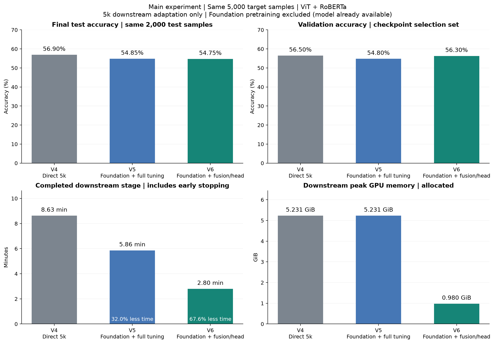
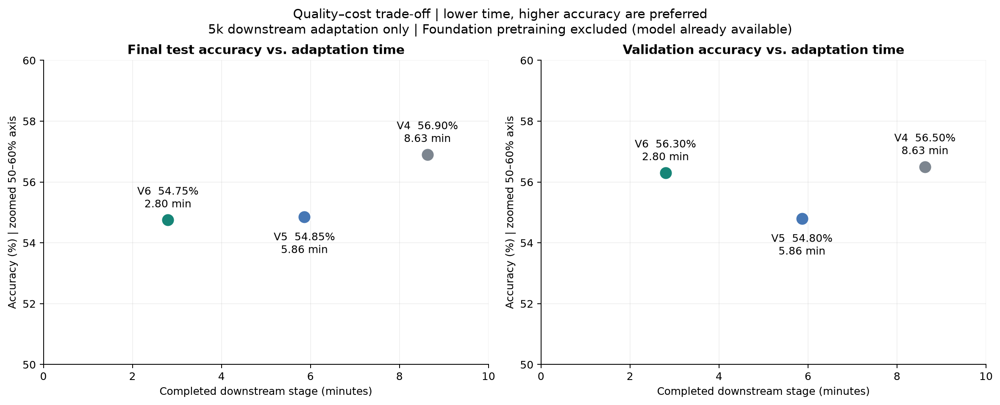
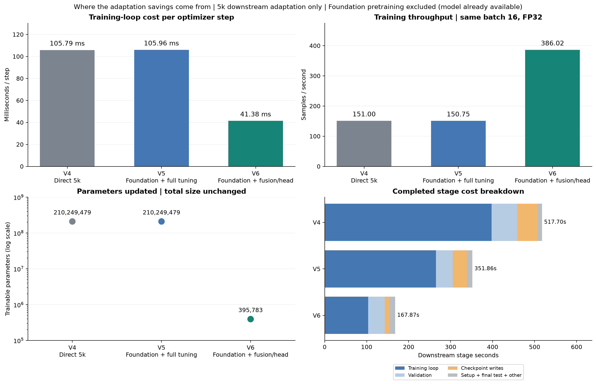
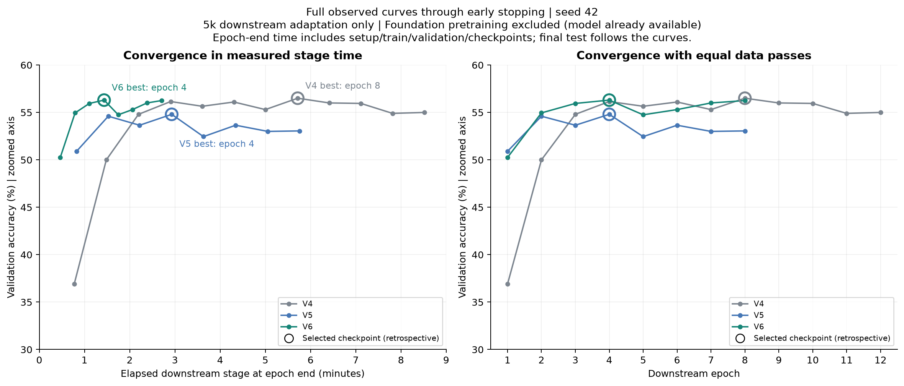

# Main experiment：复用Foundation模型的高效5k下游适配

**研究问题：当图文情绪Foundation源模型已经可用时，能否用相同的5,000条目标任务样本，以更低的适配成本获得接近直接训练基线的七分类效果？** 本报告只比较V4、V5、V6，关注使用者拿到已有模型后的目标任务适配。

在本次seed42实验中，V6冻结源编码器，仅更新融合层和分类头，将下游阶段耗时从V4的 **8.63分钟降至2.80分钟，减少67.57%，加速3.08倍**；记录的峰值allocated显存从 **5.231 GiB降至0.980 GiB，减少81.27%**。验证accuracy为56.30%对56.50%，相差0.20个百分点；最终test accuracy为54.75%对56.90%，相差2.15个百分点。结果支持**用一定效果差距换取明显更低的适配时间和显存成本**，其中验证表现尤其接近。

**成本口径：所有时间和显存图仅统计5k下游阶段，假定源模型已可用，不计源模型预训练。** “Foundation”在这里特指项目基于20k图文样本二分类训练得到的ViT-B/16 + RoBERTa-base情绪源模型；其权重和数据来源见[完整实验档案](experiment_review.md)与[协议](../docs/experiment_protocol.md)。本页没有将源模型构建成本加入比较表或图中。



[下载主结果PDF](figures/main_experiment/main_results.pdf)

## 三种适配方式与共同设置

| 方案 | 初始化 | 5k下游阶段更新范围 | 实验角色 |
|---|---|---|---|
| V4 Direct 5k | 通用预训练ViT与RoBERTa；新融合层及七分类头 | 两个编码器、融合层和分类头 | 不使用本项目源模型的直接训练基线 |
| V5 Foundation + full tuning | 继承源编码器；重新初始化融合层及七分类头 | 全参数 | 检查复用源编码器后全参数适配的效果与成本 |
| V6 Foundation + fusion/head | 继承源编码器和融合层；新七分类头 | 冻结两个编码器，训练融合层与头 | 以较少参数更新实现快速下游适配 |

三者最终架构相同：ViT图像768维和RoBERTa文本768维拼接，经256维融合层接七分类头。V4不是全部随机初始化的“从零训练”；它从通用预训练权重开始，但不使用本项目的领域源模型。V5/V6复用相同源checkpoint。

三组使用同一份Target 5k、Validation 2k和Test 2k，输入预处理与数据指纹一致；图片224×224，文本最多96 tokens。共同设置为seed42、NVIDIA H200 NVL、batch16、FP32、Adam、可训练编码器LR 5e-6、融合层/头LR 1e-4、最大20轮、patience4，以及相同的warmup/cosine计划。按validation accuracy选取best.pt，再报告该checkpoint的test结果。数据标签分布与样例见[数据集报告](dataset_review.md)。

这是**相同下游标签预算**下的适配方式比较，实际停止轮数由相同早停规则决定。V5/V6还复用了源训练获得的信息；V5与V6同时有融合层初始化和编码器更新范围的差别，三者不是只改变一个因素的严格消融。

## Main results：最终效果与下游适配成本

| 方案 | Validation accuracy | Test accuracy | Test macro-F1 | 5k阶段总耗时 | 相对V4时间减少 | 记录峰值allocated显存 |
|---|---:|---:|---:|---:|---:|---:|
| V4 | 56.50% | 56.90% | 0.5484 | 517.70秒 / 8.63分 | 基线 | 5.231 GiB |
| V5 | 54.80% | 54.85% | 0.5283 | 351.86秒 / 5.86分 | 32.03% | 5.231 GiB |
| V6 | 56.30% | 54.75% | 0.5276 | 167.87秒 / 2.80分 | 67.57% | 0.980 GiB |

这里的“最终效果”来自validation选定的best.pt，不是训练最后一轮。Validation用于选模，test与其独立；两者分别报告，不能以validation的0.20个百分点差距代替test的2.15个百分点差距。



[下载效果—成本PDF](figures/main_experiment/quality_cost_tradeoff.pdf)

散点图只比较这三个已完成的运行。横轴为完整5k阶段耗时，纵轴分别为test与validation accuracy，并明确标出50%–60%的放大坐标范围。每个点对应完整早停运行的成本及其选中checkpoint的质量，不是达到统一准确率阈值的用时。

V6是本次比较中适配成本最低的方案。相对V4，它减少约三分之二阶段时间，同时test少答对43/2,000条、macro-F1低约0.0208；是否接受这一差距取决于应用对准确率和适配成本的权衡。相对V5，V6的阶段时间减少52.29%，test accuracy仅低0.10个百分点（2条样本），validation则高1.50个百分点。V5比V4少用32.03%的阶段时间，但test accuracy低2.05个百分点、显存没有降低。

## 为什么V6的下游阶段更高效



[下载效率分解PDF](figures/main_experiment/efficiency_breakdown.pdf)

| 指标 | V4 | V5 | V6 |
|---|---:|---:|---:|
| 实际epoch / 选中epoch | 12 / 8 | 8 / 4 | 8 / 4 |
| 优化器步数 | 3,756 | 2,504 | 2,504 |
| 训练循环总耗时 | 397.36秒 | 265.33秒 | 103.62秒 |
| 平均每轮训练循环 | 33.11秒 | 33.17秒 | 12.95秒 |
| 平均每优化器步 | 105.79毫秒 | 105.96毫秒 | 41.38毫秒 |
| 训练吞吐量 | 151.00样本/秒 | 150.75样本/秒 | 386.02样本/秒 |
| 更新参数数量 | 210,249,479 | 210,249,479 | 395,783 |
| 更新参数占总参数比例 | 100% | 100% | 0.1882% |
| 峰值reserved显存（补充） | 5.924 GiB | 5.924 GiB | 1.100 GiB |

V6仍执行ViT与RoBERTa前向，但冻结编码器，不为它们进行梯度更新。训练吞吐量为V4的2.56倍，单步成本明显降低；再加上本次早停运行8轮而非12轮，共同构成阶段总耗时的下降。三个最终模型总参数数仍相同，V6没有压缩推理模型，训练显存下降也不等于推理显存按同样比例下降。

V5与V4均为全参数训练，单步耗时、吞吐量及峰值显存几乎相同。它的阶段时间较少主要来自实际只运行8轮；较早停止不等于达到与V4相同的最终质量。这个对照有助于区分“运行更少的轮次”和“每一步本身更便宜”。

主指标采用 `efficiency.stage_wall_seconds`：包含下游设置、训练循环、验证、checkpoint保存、最终测试和少量阶段内开销，且计入早停等待轮次。训练循环单独列为补充，不把它与阶段总耗时混用。该指标不包括外部数据准备、进程启动和W&B最终上传等待。显存是下游训练/验证记录的PyTorch峰值，不能解释成整张GPU的全部占用。

## 收敛过程：同样5k数据下的适配速度



[下载收敛曲线PDF](figures/main_experiment/convergence.pdf)

左图使用逐epoch末尾的累计下游阶段时间，包含设置、训练、验证和保存；最终test在曲线之后执行。右图按epoch对齐，每轮都遍历相同5,000条样本。两图展示直到早停的全部已记录轮次，圆环标出最后选中的checkpoint。

V4在第8轮取得最佳validation，V5/V6在第4轮取得各自最佳validation。在本次运行中，V6更早进入约56%的验证水平。圆环对应的累计时间分别为342.94、175.74、86.02秒；这些是**运行结束后回看最佳轮次的时间**，不是可提前知道的停止时刻。主结果仍使用全部运行成本517.70、351.86、167.87秒，避免省略早停确认过程。

## 本次实验支持的结论

> 当已有图文情绪Foundation源模型可供复用时，冻结编码器、仅适配融合层与分类头，是这组实验中成本最低的5k七分类适配方式。它以67.57%的下游阶段时间减少和81.27%的记录峰值allocated显存减少，获得接近直接训练基线的验证效果；最终test accuracy仍存在2.15个百分点差距。因此，本次证据支持低成本适配的质量—效率折中，而不是无损替代。

当前为单seed、单设备结果，没有重复计时区间或统计等效性检验。V5/V6是在查看较早实验结果后提出的探索性方案；目前的“接近”是数值描述，尚不是跨seed或新数据上的等效性结论。源/目标清单虽没有相同ID，仍共享227个精确图片哈希，因此也不把该结果描述为在完全独立的新领域上的迁移验证。

## 复核与重绘

- 原始运行：[V4](https://forge.coreweave.com/wandb/ql2505-columbia-university/tumemo-training-comparison/runs/91fae8eb7f88)、[V5](https://forge.coreweave.com/wandb/ql2505-columbia-university/tumemo-training-comparison/runs/2214987ad17a)、[V6](https://forge.coreweave.com/wandb/ql2505-columbia-university/tumemo-training-comparison/runs/dd4a5a95db85)，均已完成，沿用此前核验的指标和逐轮记录。
- [本页对比CSV](data/main_experiment.csv)与[JSON](data/main_experiment.json)：三组结果、相对变化、成本定义、曲线、共同配置及源记录SHA-256。
- [六版本完整档案](experiment_review.md)、[数据集报告](dataset_review.md)、[特征可视化](embedding_visualization.md)提供背景与补充分析。

只需仓库中的聚合数据，无需checkpoint、原始数据、GPU或W&B登录：

```bash
python -m pip install -r requirements-analysis.txt
python tools/plot_main_experiment.py
```

默认生成本报告的四组PNG/PDF及CSV/JSON；可用 `--output /path/to/new_reports` 写入独立目录。脚本检查共同数据/配置、共享源checkpoint、完整计时及checkpoint选模一致性，只读取V4自身七分类阶段与V5/V6的stage2计时。原始训练和历史指标不变。
